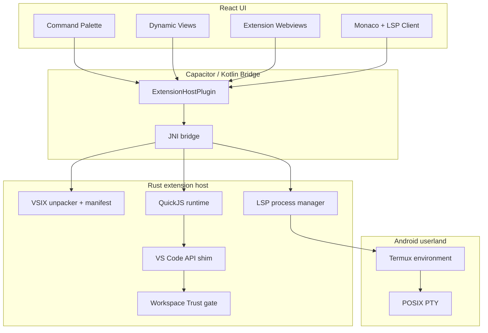
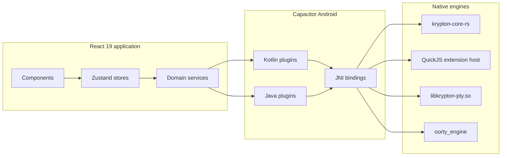

<div align="center">


# Kryptonide

### Code anywhere. Build anything.

**Version 4.0.0**

A mobile-first IDE that runs a real editor, real terminal, real filesystem, native extensions, and an agentic AI assistant on Android and the web.

[Quick start](#quick-start) · [What's new](#whats-new-in-v40) · [Architecture](#architecture) · [Extensions](#native-extension-host) · [Development](#development) · [Documentation](#documentation)

</div>

---

Krypton IDE brings a desktop-class development workflow to a phone, tablet, or browser. It combines Monaco Editor, a native POSIX terminal, a Rust execution core, VSIX extension support, GitHub workflows, and Oorty Lite — an AI agent that can read, edit, build, and navigate a project through structured tools.

Version 4 is not a cosmetic release. It adds a native extension host, an on-device agent stack, real PTY sessions, MCP connectors, agent skills, workspace trust, and a substantially deeper Android integration.

> [!NOTE]
> Krypton has two deployment paths: a browser/PWA build for web development and a Capacitor Android app for full native execution. Features such as PTY terminals, Termux language servers, native extensions, and on-device models require the Android build.

---

## Table of Contents

- [What is Krypton IDE?](#what-is-krypton-ide)
- [What's new in v4.0](#whats-new-in-v40)
- [v4.0 in numbers](#v40-in-numbers)
- [Quick start](#quick-start)
  - [Run the web app](#run-the-web-app)
  - [Build for Android](#build-for-android)
- [Feature tour](#feature-tour)
  - [Editor and workspace](#editor-and-workspace)
  - [Oorty Lite AI](#oorty-lite-ai)
  - [Native extension host](#native-extension-host)
  - [Terminal and execution](#terminal-and-execution)
  - [Git and GitHub](#git-and-github)
  - [Storage, sync, and backup](#storage-sync-and-backup)
  - [Build and release](#build-and-release)
- [Architecture](#architecture)
  - [Runtime layers](#runtime-layers)
  - [Project layout](#project-layout)
  - [Security model](#security-model)
- [Development](#development)
- [Testing](#testing)
- [Troubleshooting](#troubleshooting)
- [Documentation](#documentation)
- [Contributing](#contributing)
- [License](#license)
- [Credits](#credits)

---

## What is Krypton IDE?

| | |
|---|---|
| **Primary target** | Android (Capacitor 8), with a browser/PWA build |
| **Editor** | Monaco Editor with LSP, themes, snippets, formatting, and mobile input controls |
| **Terminal** | Native POSIX PTY with optional Termux userland bootstrap |
| **Extensibility** | VSIX installation, Rust + QuickJS extension host, VS Code API subset, LSP |
| **AI** | Oorty Lite agent, live model discovery, tool calling, MCP, skills, AIF memory |
| **Native core** | Rust (`krypton-core-rs`), JNI, Android Kotlin plugins, C/C++ PTY bridge |
| **Storage** | Device filesystem, OPFS/IndexedDB for web, Google Drive backup |
| **Source control** | isomorphic-git, GitHub OAuth, repository management, Actions builds |
| **License** | MIT |

### Who it is for

- Developers who want to inspect, edit, and ship code from a phone or tablet.
- People who need a real terminal and filesystem instead of a browser-only sandbox.
- AI-first workflows that need project context, tools, memory, and external MCP servers.
- Extension authors who want VS Code-style packages in a lightweight mobile runtime.

---

## What's new in v4.0

### Native extension host

The largest change in v4 is a real extension runtime:

- Install genuine `.vsix` packages from a local file or the Open VSX marketplace.
- Unpack and validate VSIX archives in Rust with manifest checks and zip-slip protection.
- Execute extension code in an embedded QuickJS runtime.
- Use a curated VS Code API subset: `commands`, `window`, `workspace`, `Uri`, `Disposable`, status bar items, configuration, and `vscode-languageclient`.
- Use Node compatibility modules: `path`, `os`, `events`, `fs`, and `child_process`.
- Connect language servers over stdio JSON-RPC to Monaco Editor.
- Render dynamic activity bar containers, sidebar views, commands, status bar items, themes, and settings.
- Run extension webviews through a constrained host bridge.
- Gate process execution and filesystem writes behind Workspace Trust.

See [Native extension host](#native-extension-host) and the [extension authoring guide](docs/extensions/extension-authoring-guide.md).

### Oorty Lite agent stack

- Live model discovery from provider `/models` endpoints instead of hardcoded model lists.
- Ten provider integrations, including Gemini, Claude, OpenAI, DeepSeek, OpenRouter, NVIDIA NIM, Groq, Moonshot, Ollama, and custom OpenAI-compatible servers.
- Streaming responses, saved models, reasoning controls, attachments, `@` context, and slash commands.
- Structured tool calling for files, diffs, search, terminal commands, Android builds, AIF memory, and MCP tools.
- Agent Skills with built-in workflows and importable Markdown + YAML frontmatter skills.
- MCP server presets and custom HTTP/SSE connectors injected into the agent tool registry.
- AIF cognitive memory with per-project boot recall, volatile scratch space, and end-of-turn commits.
- Agent Harness registry for the built-in Oorty Lite agent and installed CLI harnesses.

### Terminal and execution

- Real POSIX PTY sessions through `libkrypton-pty.so`.
- Separate Project Shell and System Shell tabs.
- Termux userland bootstrap with package installation helpers.
- Docked or floating terminal panel, resize handling, shell restart, output buffering, and ANSI rendering.
- LSP servers launched inside the Termux environment and connected back to Monaco.

### Release and reliability work

- Rust acceleration for search, diffing, ZIP handling, filesystem traversal, hardware topology, AIF serialization, and Git-oriented operations.
- Hardened preview, build, terminal, and AI flows.
- Android CI with SDK 36, JDK 21, NDK 27, and APK artifact upload.
- Release tracking, APK installation, and GitHub Actions build integration.
- Expanded frontend and Rust test coverage across the six extension-host phases.

---

## v4.0 in numbers

These figures compare `v3.0.0` with the v4 release checkpoint at commit `3e85600`.

**Baseline:** `v3.0.0` = `158f0077cef93f8c847532e94151f5a209b6fb96` (2026-05-08), the “Release v3.0: Larry AI, Native Execution, Utilities & Fixes” commit.

| Metric | v3.0.0 → v4.0.0 |
|---|---:|
| Commits | **92** |
| Files changed | **344** |
| Lines added | **+65,939** |
| Lines removed | **−7,762** |
| Net line change | **+58,177** |
| Files added | **272** |
| Files modified | **62** |
| Files deleted | **7** |
| Files renamed | **3** |

Source, native, and test code only (`src/`, `crates/`, `android/`, `tests/`):

| Files | Added | Removed | Net |
|---:|---:|---:|---:|
| **266** | **+52,960** | **−5,807** | **+47,153** |

Where the change landed in selected areas:

| Area | Files | Added | Removed |
|---|---:|---:|---:|
| `src/` | 120 | +32,125 | −5,536 |
| `crates/` | 40 | +10,463 | — |
| `android/` | 57 | +6,382 | −271 |
| `tests/` | 49 | +3,990 | — |
| `docs/` | 22 | +4,611 | — |
| `scripts/` | 14 | +3,323 | — |
| Other files | 42 | +5,045 | −1,955 |
| **Total** | **344** | **+65,939** | **−7,762** |

> [!NOTE]
> Totals include tests, documentation, generated assets, and lockfile changes. The area breakdown covers every changed file in the v4 comparison range.

Reproduce the summary with:

```bash
git diff --shortstat v3.0.0..3e85600
git diff --name-status v3.0.0..3e85600
git log --oneline v3.0.0..3e85600
```

---

## Quick start

### Prerequisites

| Workflow | Requirements |
|---|---|
| Web development | Node.js 22+, npm 10+, a modern Chromium or Firefox browser |
| Android build | Android Studio, Android SDK 36, build-tools 36.0.0, JDK 21, NDK 27.0.12077973, CMake 3.22.1 |
| Native core changes | Rust stable, Cargo, `cargo-ndk` for Android targets |
| Optional services | Firebase project for Google Sign-In, provider API keys for hosted AI models |

The Android app includes prebuilt native libraries under `android/app/src/main/jniLibs/`. Rebuild them only if you change the Rust core.

### Run the web app

```bash
git clone git@github.com:Sednium-Technologies/krypton-ide.git
cd krypton-ide
npm ci --legacy-peer-deps
cp .env.example .env
npm run dev
```

Open `http://localhost:3000`.

The development server binds to `0.0.0.0` so it can be opened from another device on the same network.

### Build for Android

```bash
npm run cap:build
npm run cap:android
```

Or run the steps individually:

```bash
npm run build
npx cap sync android
npx cap open android
```

For a command-line debug build:

```bash
cd android
./gradlew assembleDebug
```

Output:

```text
android/app/build/outputs/apk/debug/app-debug.apk
```

> [!IMPORTANT]
> Do not commit API keys, signing keystores, or environment files. Use your own Firebase configuration and Android signing credentials when building a distributable APK.

### Configuration

| File or setting | Purpose |
|---|---|
| `.env` | Web environment values such as `VITE_GOOGLE_CLIENT_ID` |
| `android/app/google-services.json` | Firebase/Google services configuration for Android |
| `android/app/release.keystore` | Release signing keystore; never commit |
| Settings → Agent | AI provider keys, saved models, MCP servers, skills, and Pocket Server controls |
| Settings → Appearance | Theme, typography, custom fonts, icon theme, and haptics |

Example `.env`:

```dotenv
VITE_GOOGLE_CLIENT_ID="your-google-client-id.apps.googleusercontent.com"
```

AI provider keys are entered in the app. They are not part of the repository configuration.

---

## Feature tour

<details id="editor-and-workspace">
<summary><strong>Editor and workspace</strong></summary>

- Monaco Editor with syntax highlighting, diagnostics, hover, completions, and document lifecycle integration.
- Command palette, go-to-line, find and replace, project-wide search, and file navigation.
- Multiple themes, custom fonts, language icons, icon themes, snippets, and persisted editor state.
- Project dashboard for creating, importing, opening, and managing workspaces.
- File explorer with create, rename, duplicate, copy, paste, download, share, delete, copy path, ZIP import, and ZIP export.
- Mobile editing toolbar with undo, redo, paste, find, and haptic feedback.
- Auto-save on interval, blur, visibility change, and project transitions.
- Keyboard-aware layout, status bar metrics, responsive panels, and landscape support.

</details>

<details id="oorty-lite-ai">
<summary><strong>Oorty Lite AI</strong></summary>

- Agentic chat with streaming responses and multi-step tool execution.
- Live model discovery from each provider instead of a fixed model roster.
- Saved model configurations with provider, base URL, context window, output limit, reasoning effort, and thinking budget.
- Context attachments through `@` mentions, diagnostics, selected files, and image attachments.
- Slash-command picker, built-in Agent Skills, and importable Markdown skills.
- Tool registry spanning filesystem operations, edits, patches, search, terminal commands, build actions, AIF memory, and external MCP tools.
- MCP support with GitHub, web fetch, filesystem, and custom HTTP/SSE connectors.
- AIF V4 cognitive memory with project scoping, boot recall, volatile scratch, importance scoring, tags, and commits.
- Native Pocket Server controls for local models, hardware topology, execution tier, and model selection.
- Agent Harness registry with supervised, autonomous, and unbound execution modes.

Supported providers:

| Provider | Default endpoint | Notes |
|---|---|---|
| Google Gemini | `generativelanguage.googleapis.com` | Multimodal models discovered live |
| Anthropic Claude | `api.anthropic.com` | Live model discovery |
| OpenAI | `api.openai.com` | Reasoning and coding models discovered live |
| DeepSeek | `api.deepseek.com` | Reasoning and coding models |
| OpenRouter | `openrouter.ai/api` | Unified model gateway |
| NVIDIA NIM | `integrate.api.nvidia.com` | Accelerated inference endpoints |
| Groq | `api.groq.com` | Low-latency inference |
| Moonshot | `api.moonshot.cn` | Long-context models |
| Ollama | `localhost:11434` | Local/offline models |
| Custom OpenAI | Configurable | vLLM, LM Studio, LocalAI, proxies, and compatible gateways |

</details>

<details>
<summary><strong>Native extension host</strong></summary>

- Local `.vsix` installation and Open VSX marketplace installation.
- Rust manifest parser and VSIX unpacker with archive validation.
- Embedded QuickJS engine with CommonJS `require`, console forwarding, and microtask pumping.
- Extension lifecycle activation and deactivation.
- Commands contributed into the command palette.
- Dynamic activity bar containers, views, status bar items, configuration pages, themes, and snippets.
- Runtime webviews with host-message scoping and URL restrictions.
- Workspace Trust with restricted mode, consent prompts, and process/filesystem gates.
- LSP client over stdio JSON-RPC with Monaco diagnostics, hover, and completions.
- Node polyfills for core modules used by common extensions.
- End-to-end fixture coverage across six implementation phases.

</details>

<details id="terminal-and-execution">
<summary><strong>Terminal and execution</strong></summary>

- Native PTY engine, not a simulated command runner.
- Project Shell opens inside the active workspace.
- System Shell opens in the Termux home directory.
- Termux bootstrap detection, installation progress, and package helpers.
- Shell output streaming into xterm.js with ANSI handling and resize propagation.
- Restart, clear, copy, and paste actions.
- Docked or floating terminal panel.
- Tool scanner that reports actual availability of common commands.
- Language servers launched through the Termux userland and connected to the editor.

</details>

<details id="git-and-github">
<summary><strong>Git and GitHub</strong></summary>

- GitHub Device Flow login and personal access token fallback.
- Repository browsing, linking, creation, and cloning workflows.
- Stage, commit, branch, diff, push, and pull operations through the Git service layer.
- GitHub Actions APK build triggering.
- Workflow run tracking and artifact download.
- Release tracker and APK installation integration.
- GitHub OAuth permissions for repository and workflow access.

</details>

<details id="storage-sync-and-backup">
<summary><strong>Storage, sync, and backup</strong></summary>

- Projects stored as ordinary files in a configurable device-storage root, for example `/sdcard/Documents/KryptonIDE`.
- Web storage backed by OPFS and IndexedDB.
- ZIP project import and export.
- Google Drive AppData backup and restore with zip-slip protection.
- Debounced and lifecycle-aware auto-save.
- Project-scoped chat sessions, AI memory, and settings.
- Firebase authentication for Google Sign-In.
- Configurable storage permissions and external folder access on Android.

</details>

<details id="build-and-release">
<summary><strong>Build and release</strong></summary>

- Web production builds through Vite.
- Capacitor synchronization for Android.
- Android debug and release builds through Gradle.
- Local Android build service and release configuration checks.
- GitHub Actions workflow `build-android.yml` with debug/release input.
- APK artifact upload with 30-day retention.
- Release signing through a keystore and CI secrets.
- Version metadata: `versionCode 40`, `versionName "4.0"`.

</details>

<details>
<summary><strong>Mobile experience</strong></summary>

- One-handed navigation, compact toolbars, and touch-friendly controls.
- Haptic feedback for key actions.
- Keyboard resize handling and accessory keys.
- Notch, status bar, and navigation bar integration.
- Warm dark and light themes with instant switching.
- Resizable sidebar, bottom panel, and floating terminal.
- Responsive behavior for portrait, landscape, and tablet layouts.

</details>

---

## Native extension host

Krypton does not fake extensions with hardcoded panels. A VSIX is unpacked, validated, indexed, activated, and executed through a native host.



### Install an extension

1. Open **Extend** in the activity bar.
2. Choose **Install .vsix** for a local package, or browse the marketplace tab.
3. Review any permission or trust prompt.
4. Open the extension details to activate it and inspect its contributions.

### Supported surfaces

| Surface | Status |
|---|---|
| `vscode.commands` | Register and execute commands |
| `vscode.window` | Messages, status bar items, and notifications |
| `vscode.workspace` | Configuration access |
| `vscode.Uri` / `vscode.Disposable` | Supported |
| `vscode-languageclient/node` | Supported through the LSP bridge |
| Activity bar containers and views | Supported |
| Status bar contributions | Supported |
| Themes and snippets | Supported |
| Runtime webviews | Supported through a constrained bridge |
| Node compatibility | `path`, `os`, `events`, `fs`, `child_process` |

> [!WARNING]
> The host implements a curated VS Code API subset. It is not a full desktop VS Code or Electron runtime. Extensions that depend on unimplemented APIs, native Node addons, or unrestricted process access may not work.

### Author an extension

Use the [Native Extension Authoring Guide](docs/extensions/extension-authoring-guide.md) for:

- VSIX structure and manifest fields.
- Command and activation event registration.
- Status bar and view contributions.
- Workspace Trust declarations.
- LSP server setup.
- Node compatibility details.
- Webview messaging rules.
- Packaging and installation.

---

## Architecture

### Runtime layers



| Layer | Responsibility | Key paths |
|---|---|---|
| UI | Editor, panels, dialogs, terminal, chat, settings | `src/components/` |
| State | Projects, editor, AI, extensions, trust, LSP, terminal | `src/store/` |
| Services | Filesystem, Git, GitHub, AI, extensions, storage, builds | `src/lib/` |
| Android bridge | Capacitor plugins and JNI entry points | `android/app/src/main/java/com/sednium/kryptonide/` |
| Native C/C++ | PTY bridge and Oorty engine | `android/app/src/main/cpp/` |
| Rust core | Search, diff, ZIP, AIF, extension host, LSP, hardware | `crates/krypton-core-rs/` |
| Tests | TypeScript and Rust suites | `tests/`, `crates/krypton-core-rs/tests/` |

### Project layout

<details>
<summary><strong>Expand repository tree</strong></summary>

```text
krypton-ide/
├── android/
│   ├── app/
│   │   ├── src/main/
│   │   │   ├── cpp/                  # PTY and Oorty C/C++ engines
│   │   │   ├── java/.../kryptonide/  # Kotlin/Java Capacitor plugins
│   │   │   └── jniLibs/              # Prebuilt Rust libraries by ABI
│   │   └── build.gradle
│   └── variables.gradle
├── assets/                           # Repository artwork
├── crates/
│   └── krypton-core-rs/
│       ├── src/                      # Rust core, JNI bridge, QuickJS host
│       └── tests/                    # Rust extension-host and core suites
├── docs/
│   ├── design/                       # Architecture and implementation designs
│   ├── extensions/                   # Extension authoring guide
│   ├── features.md                   # Settings and capability ledger
│   └── performance_baseline_report.md
├── scripts/                          # Audits, benchmarks, and verification tools
├── src/
│   ├── components/                   # React UI
│   ├── config/                       # Providers, prompts, editor configuration
│   ├── lib/                          # AI, Git, storage, LSP, terminal, builds
│   ├── store/                        # Zustand state
│   └── main.tsx
├── tests/                            # TypeScript test suites and VSIX fixtures
├── capacitor.config.json
├── package.json
├── vite.config.ts
└── README.md
```

</details>

### Data flow

| Operation | Flow |
|---|---|
| Edit a file | Monaco → editor store → filesystem service → device storage or OPFS |
| Run a command | Terminal panel → native terminal bridge → PTY → shell → xterm.js |
| Install an extension | Extensions panel → VSIX reader → Kotlin plugin → JNI → Rust unpacker → QuickJS activation |
| Use a language server | Monaco → LSP client → Kotlin plugin → Rust LSP manager → Termux process → JSON-RPC |
| Send an AI message | Chat → provider adapter → stream → tool registry → file/build/MCP tools → AIF commit |
| Build an APK | Build panel → GitHub service or local build service → Actions/Gradle → artifact download |

### Security model

- **Workspace Trust:** restricted mode blocks process execution and filesystem writes outside the workspace until the user explicitly trusts the workspace.
- **Extension consent:** manifests that require process access declare it, and the UI surfaces the requirement before installation or activation.
- **VSIX validation:** archive paths are checked against zip-slip traversal and manifests are validated before execution.
- **Webview isolation:** host messages are scoped and unsafe navigation is blocked.
- **Secrets:** environment files and keystores are excluded from Git; provider keys are entered locally in the app.
- **Package integrity:** release signing is handled through Gradle and CI secrets.
- **Curated API surface:** extension code receives only the implemented VS Code APIs and Node polyfills.

> [!CAUTION]
> Treat untrusted workspaces and third-party extensions as untrusted code. Review trust prompts and extension permissions before granting access.

---

## Development

### Available scripts

| Command | Purpose |
|---|---|
| `npm run dev` | Start Vite on port 3000 |
| `npm run build` | Create a production web build |
| `npm run preview` | Preview the production build |
| `npm run clean` | Remove `dist/` |
| `npm test` | Run the TypeScript test suite |
| `npm run type-check` | Run `tsc --noEmit` |
| `npm run lint` | Alias for `tsc --noEmit` |
| `npm run cap:sync` | Build is not implied; sync assets to Android |
| `npm run cap:build` | Build web assets and sync Capacitor |
| `npm run cap:android` | Open the Android project in Android Studio |

### Useful direct commands

```bash
# Type-check the frontend
npm run type-check

# Run all frontend tests
npm test

# Run the Rust core tests
cargo test --manifest-path crates/krypton-core-rs/Cargo.toml

# Compile Android Kotlin and Java sources
./android/gradlew -p android :app:compileDebugKotlin :app:compileDebugJavaWithJavac

# Build a debug APK
./android/gradlew -p android assembleDebug

# Build a release APK with a configured keystore
KEYSTORE_PASSWORD="your-password" ./android/gradlew -p android assembleRelease
```

### Native library notes

- `libkrypton_core_rs.so` is provided for `arm64-v8a`, `armeabi-v7a`, and `x86_64`.
- The PTY bridge and Oorty engine are built by CMake during the Gradle build.
- Rust changes require rebuilding the Android `cdylib` with the NDK toolchain before packaging.
- Web/WASM paths use worker and typed-array boundaries where available.

### Code conventions

- React function components and hooks.
- Zustand stores for shared state.
- Service modules under `src/lib/` for platform and domain logic.
- Static typing across the frontend; run `npm run type-check` before submitting changes.
- Keep native and TypeScript boundaries explicit through the Capacitor bridge.
- Add tests for behavior that crosses UI, native, or extension-host boundaries.

---

## Testing

The repository uses two test layers.

### Frontend

```bash
npm test
npm run type-check
```

The TypeScript suite covers extension lifecycle, VSIX packaging, command palette integration, configuration, navbar contributions, status bar items, trust UI, LSP client behavior, terminal installation, webview bridges, AI tool registration, Pocket Server behavior, release tracking, and storage/authentication helpers.

### Rust core

```bash
cd crates/krypton-core-rs
cargo test
```

The Rust suites cover manifest parsing, installation, lifecycle, LSP, Node compatibility, trust gates, status bar behavior, VS Code API behavior, webview handling, hardening, and hardware topology.

### Android

```bash
cd android
./gradlew :app:compileDebugKotlin :app:compileDebugJavaWithJavac
```

For device-level verification, build and install a debug APK, then exercise the terminal, extension installation, workspace trust, LSP, and build flows on hardware.

> [!TIP]
> Run `npm run type-check` and the Rust tests before opening a pull request. Native changes should also be verified with an Android compile.

---

## Troubleshooting

<details>
<summary><strong>The native extension host is unavailable</strong></summary>

Check that the correct `libkrypton_core_rs.so` exists for the device ABI under `android/app/src/main/jniLibs/`. Confirm that the Android plugin is registered and that the app was rebuilt after changing native code. The extension host requires an Android build; the browser build does not provide the native runtime.

</details>

<details>
<summary><strong>A VSIX installs but does not activate</strong></summary>

Inspect the extension manifest for a valid publisher, name, version, activation events, and entry point. Check whether the extension depends on APIs outside the supported subset. Review the extension detail view and logs. Extensions that require unrestricted Node access or native addons may not run.

</details>

<details>
<summary><strong>The terminal cannot start or bootstrap Termux</strong></summary>

The terminal requires the Android build and a working native PTY library. Open the terminal setup flow, install the Termux bootstrap when prompted, and verify storage permissions. If a session is stuck, restart it from the terminal toolbar.

</details>

<details>
<summary><strong>Language servers do not start</strong></summary>

LSP servers run inside the Termux userland. Confirm the bootstrap is installed, the server binary is available on the expected path, and the language server supports stdio JSON-RPC. Check the LSP status indicator and the terminal package helper.

</details>

<details>
<summary><strong>Android build fails while resolving the SDK</strong></summary>

Install Android SDK 36, build-tools 36.0.0, NDK 27.0.12077973, and CMake 3.22.1. Use JDK 21. Confirm `android/local.properties` points to the SDK. The CI workflow installs the same toolchain.

</details>

<details>
<summary><strong>npm install fails on optional native dependencies</strong></summary>

Use the repository's CI-compatible install command:

```bash
npm ci --legacy-peer-deps
```

If lifecycle scripts fail on a platform-specific optional package, retry with `--ignore-scripts` only when the affected package is not required for your target.

</details>

<details>
<summary><strong>The web build stalls or runs out of memory</strong></summary>

Increase the Node heap for the build process:

```bash
NODE_OPTIONS=--max-old-space-size=4096 npm run build
```

Close other memory-heavy processes and confirm the environment meets the Node.js 22 requirement.

</details>

<details>
<summary><strong>Google Sign-In fails</strong></summary>

Set `VITE_GOOGLE_CLIENT_ID` in `.env`, provide a matching Firebase configuration, and verify the Android OAuth client SHA-1. Rebuild and sync Capacitor assets after changing environment values.

</details>

<details>
<summary><strong>Google Drive backup or restore fails</strong></summary>

Re-authenticate the Google account, confirm Drive access is authorized, and check that the backup exists. Restore overwrites local workspace data, so confirm the warning before proceeding.

</details>

---

## Documentation

| Document | Contents |
|---|---|
| [Extension authoring guide](docs/extensions/extension-authoring-guide.md) | VSIX structure, API subset, trust, LSP, contributions, packaging |
| [Native extension host design](docs/design/krypton-native-extension-host.md) | Host architecture and phased implementation |
| [Rust core architecture](docs/design/krypton-core-rust-architecture.md) | JNI/WASM boundaries, search, diff, ZIP, AIF, Git, hardware |
| [Command palette and agent harness](docs/design/command-palette-and-agent-harness-system.md) | Palette integration and agent execution design |
| [Features ledger](docs/features.md) | Settings, accounts, storage, themes, sync, and system paths |
| [Performance baseline](docs/performance_baseline_report.md) | Benchmarks and optimization targets |
| [Audit report](docs/AUDIT_REPORT.md) | Security, stability, and performance findings |
| [Changelog and porting notes](docs/changelog.md) | Feature implementation notes and architecture changes |
| [Project overview](docs/kryptonide.md) | Product and subsystem overview |

Verification helpers live in `scripts/` and `.agents/skills/verify-krypton-ide/`.

---

## Contributing

1. Fork the repository and create a focused branch.
2. Install dependencies with `npm ci --legacy-peer-deps`.
3. Make the change with tests where behavior crosses a boundary.
4. Run `npm test`, `npm run type-check`, and the relevant Rust or Android checks.
5. Open a pull request describing the problem, the change, and the verification performed.

Please keep changes scoped. Native, extension-host, and storage changes should include an explanation of the security and compatibility impact.

---

## License

MIT License. Copyright (c) 2026 Sednium.

See [LICENSE](LICENSE) for the full text.

---

## Credits

Built by **Sednium** and **Bhoid**.

Krypton IDE stands on the work of the React, Monaco, Capacitor, Rust, QuickJS, xterm.js, Tailwind, Zustand, isomorphic-git, and open-source Android communities.
